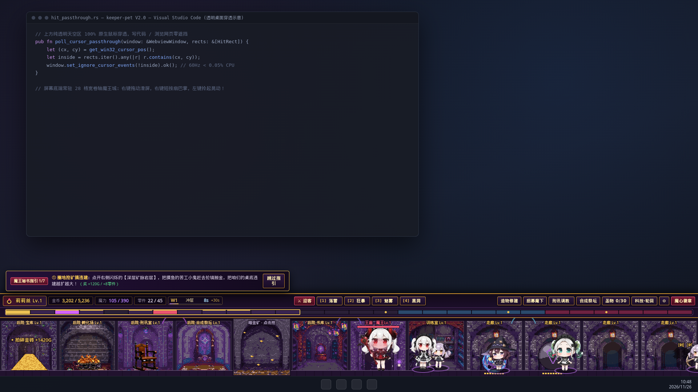
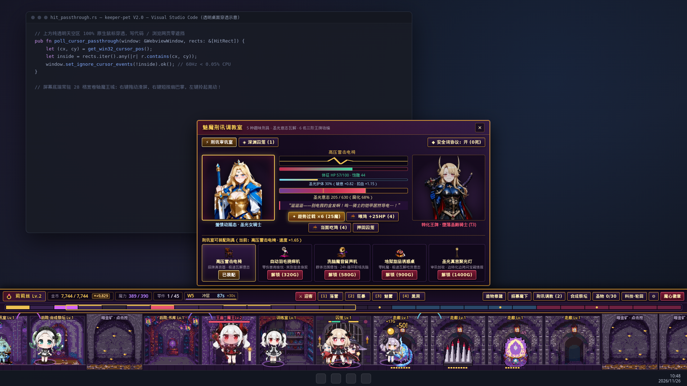
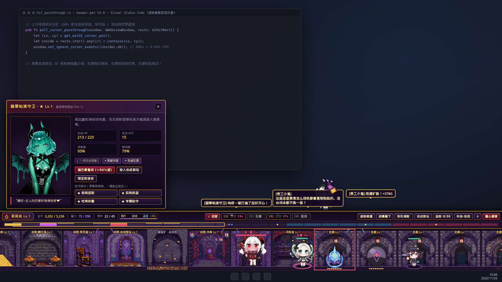
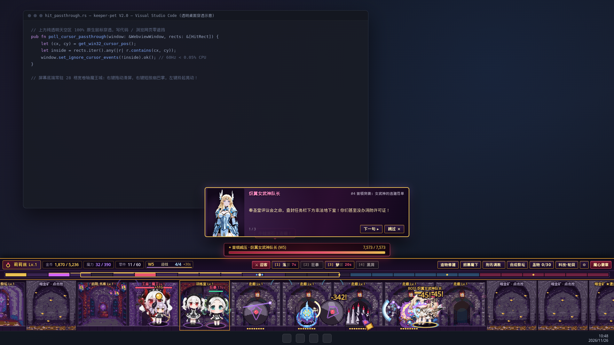
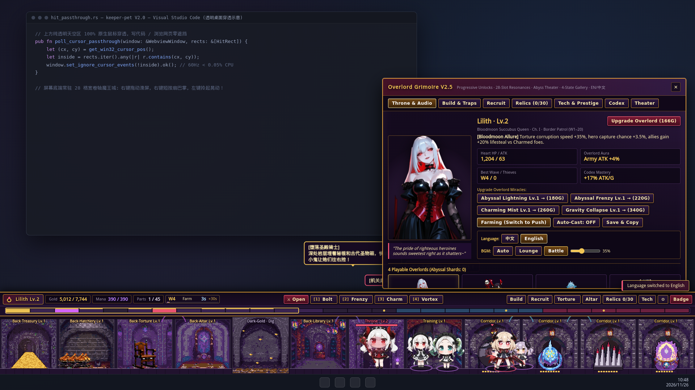
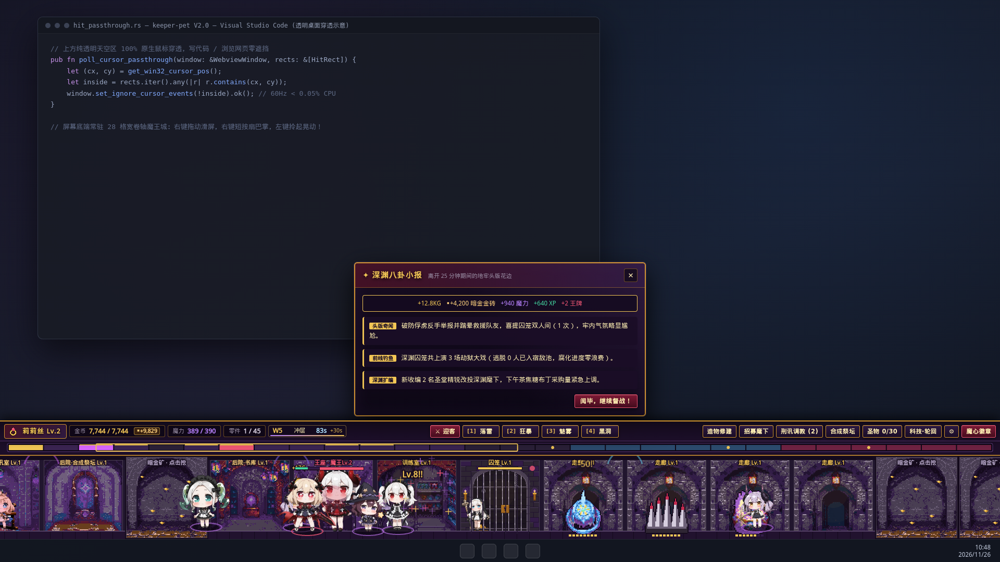
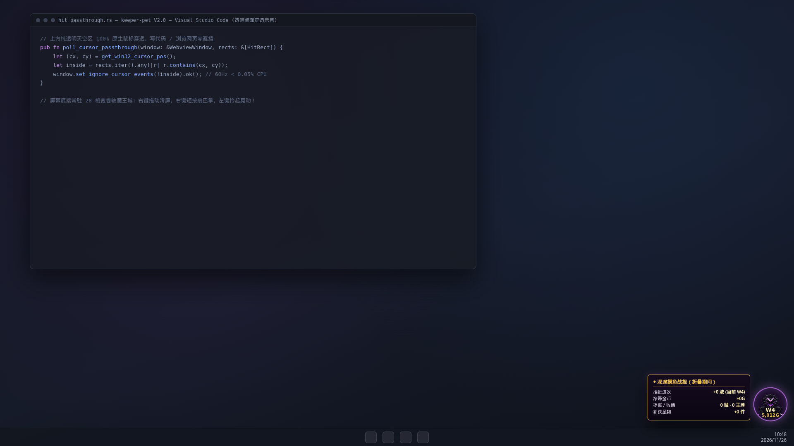

# Abyss Keeper Pet · 《深渊饲主：桌底魔王城》

> **"It's good to be bad — right above your Windows taskbar."**  
> 驻留在屏幕底端任务栏上方的**暗黑哥特风地下城经营放置桌宠**（致敬《地下城守护者》与《地牢制造者》）。

<p align="center">
  <a href="https://occcc-bot.github.io/abyss-keeper-pet/">
    
  </a>
  &nbsp;&nbsp;
  <a href="https://github.com/occcc-bot/abyss-keeper-pet/releases/latest/download/AbyssKeeperPet-v2.5.0-Win64.zip">
    
  </a>
</p>

---

### 网页试玩
- 👉 **在线试玩地址**：**[https://occcc-bot.github.io/abyss-keeper-pet/](https://occcc-bot.github.io/abyss-keeper-pet/)**  

### Windows 桌面透明穿透完整版（推荐！）
1. **点击直接下载压缩包**：👉 **[AbyssKeeperPet-v2.5.0-Win64.zip（约 11 MB）](https://github.com/occcc-bot/abyss-keeper-pet/releases/latest/download/AbyssKeeperPet-v2.5.0-Win64.zip)**  

---



---

## 中文介绍

**《深渊饲主：桌底魔王城》** 是一款驻留在你电脑屏幕底端、紧贴任务栏上方的**暗黑哥特风地下城经营放置桌宠**。

你将扮演落魄苏醒的魔王，在屏幕最底端悄悄扩建自己的地下魔王城。地牢屋顶上方的桌面区域**完全鼠标穿透**——你尽可以在屏幕上半部分安心写代码、办公或看视频，互不抢焦点；闲暇低头看一眼，就能欣赏手下挖矿、吃鸡、拌嘴，或是看正义凛然的勇者小队一头撞进你布好的滚石杀阵。

### 玩法亮点
- **横切面地下城基建与防盗**：指挥苦工小鬼向深处开挖金矿，自由规划宝库、孵化场、书库、工坊、训练室与前线走廊陷阱。偶尔还会有潜行女飞贼绕过防线摸进后院偷金，记得派守卫看门——或者干脆亲手把她抓回来！
- **经典的「魔王之手」直觉交互**：鼠标伸进地牢就是你的邪恶魔爪——**左键长按**把偷懒闲逛的部下拎起来晃荡着丢进训练室，或是把逃跑的偷金贼直接摔回陷阱上；**右键轻扇一巴掌**，就能把摸鱼苦工拍进委屈又卖命的狂暴加速状态。
- **抓捕勇者、关押监牢与调教策反**：从地面闯入的圣骑士、神射手与大法师不只是经验包，更是你的潜在王牌。把击败的勇者关进**深渊囚笼**消磨锐气、提防同伴劫狱，再押上**刑讯调教室**——用电椅、挠痒羽毛、甜品诱惑或是“当面吃烤鸡”瓦解她们的圣光意志，将昔日宿敌彻底收编为麾下精锐。
- **养成、合成与小人生态**：4 位风格迥异的可选魔王、祭坛高阶合成、30 件深渊圣物，外加摸鱼怪、夜猫子、大胃王、欢喜冤家等 14 种角色性格——哪怕你不操作，看着地底一群活宝自顾自吐槽互动也足够解闷。
- **真正不打扰干活的佛系桌宠**：满仓溢出的金币会自动铸成金砖留存，不用担心几分钟不看就白挂；需要专注或开会时，点一下右下角**魔心徽章（老板键）**即可一键折叠成角落里安静呼吸的小水晶，内置**简体中文 / English** 一键切换与双轨哥特背景音乐。

---

## English Overview

**Abyss Keeper Pet** turns the bottom strip of your screen into a living, side-scrolling underground kingdom.

- 🎮 **Play Instantly in Browser**: **[https://occcc-bot.github.io/abyss-keeper-pet/](https://occcc-bot.github.io/abyss-keeper-pet/)**
- ⬇️ **Windows Taskbar Desktop Pet (`.zip` Portable — Extract & Play)**: **[Download AbyssKeeperPet-v2.5.0-Win64.zip](https://github.com/occcc-bot/abyss-keeper-pet/releases/latest/download/AbyssKeeperPet-v2.5.0-Win64.zip)** *(Extract the `.zip` and double-click `keeper-pet.exe` — do not click the green `Code` button unless you want source code. If Windows SmartScreen appears on first run, click `More info` → `Run anyway`.)*

### What You Do in the Abyss
- **Carve Out a Cutaway Dungeon**: Send imps to mine gold veins, unlock new territory, and arrange a 28-slot cross-section of Treasuries, Hatcheries, Libraries, Workshops, Training Rooms, and trap-lined corridors. Beware of sneaky thieves slipping into your backyard vault!
- **Wield the *Hand of Evil***: Reach directly into the dungeon with your cursor. Pick up slacking minions by the scruff of their neck and drop them where they're needed, hurl fleeing gold thieves back onto rolling boulders, or give lazy workers a quick **Slap!** to send them into a panicked work frenzy.
- **Capture, Imprison & Corrupt Heroes**: Lock defeated heroes in the **Abyssal Prison** (while watching out for rescue raids from their friends!), wear down their resolve, and bring them to the **Torture Chamber**—complete with electric chairs, feather ticklers, dessert tables, and roast-chicken mind games—to turn them into loyal dark champions.
- **Grow Your Dark Legion**: Choose from 4 playable Overlords, fuse minions at the Altar into higher-tier elites, unearth 30 ancient relics, and watch 14 distinct personality quirks bicker in speech bubbles while they go about their day.
- **Designed for Relaxed Side-Screen Idling**: Everything above the dungeon roof is **100% click-through** on Windows. Overflowing gold is safely stored in reserve bullion, and hitting the **Boss Key** folds the whole castle into a tiny breathing crystal in the corner of your screen.

---

## Screenshots · 实机画面

| Torture Chamber & Abyssal Prison | Hand of Evil & HD Portraits |
| :---: | :---: |
|  |  |

| Hero Invasion & Corridor Traps | Live English UI & Audio Console |
| :---: | :---: |
|  |  |

| Abyssal Gazette Chronicle | Boss-Key Mini Crystal Mode |
| :---: | :---: |
|  |  |

---

## Controls · 操作一览

| Input / 操作 | Action / 效果 |
| :--- | :--- |
| **Right-Click Drag / Mouse Wheel** | 右键按住拖动 / 滚轮横移地下城视野 (`Pan across the dungeon`) |
| **Right-Click Tap (`Slap!`)** | 右键短按扇巴掌督战加速 (`Slap a minion into a work/combat frenzy`) |
| **Left-Click Hold & Drag** | 左键拎起角色投放房间/摔陷阱 (`Pick up & drop minions, captives, or thieves`) |
| **Left-Click Throne / Unit / Vein** | 点击王座升级 / 点角色看立绘 / 点岩层挖矿 (`Inspect & command`) |
| **Bottom-Right Badge / System Tray** | 一键折叠为角落魔心徽章老板键 (`Fold into stealth mini-crystal mode`) |

---

## Build from Source · 开发者源码编译

*(普通玩家无需看本节，直接点页面最上方按钮试玩或下载 `.zip` 解压即玩！)*

Requires **Node.js 20+** (and **Rust** if compiling the native Windows desktop pet):

```bash
# Run in browser (Linux / macOS / Windows)
npm install
npm run dev

# Run unit tests & build web bundle
npm run typecheck
npm run test:unit
npm run build

# Build native Windows executable on Windows (Rust + MSVC Build Tools)
cargo build --release --manifest-path src-tauri/Cargo.toml
```

---

## License · 开源协议

Released under the [MIT License](LICENSE) (includes generative AI art/music asset disclosure).
